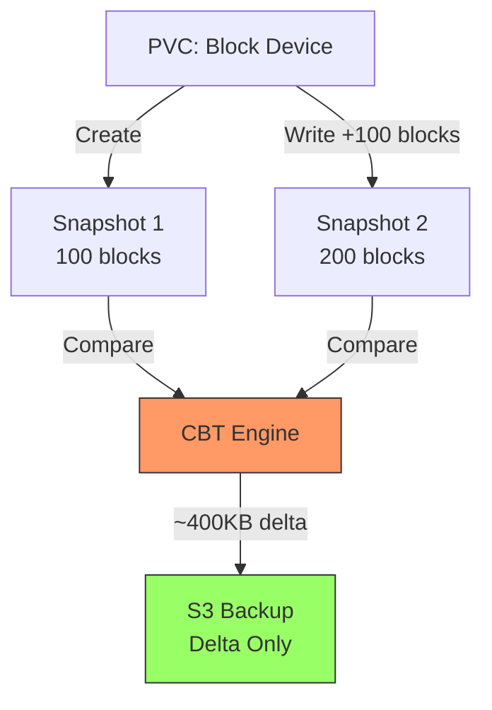
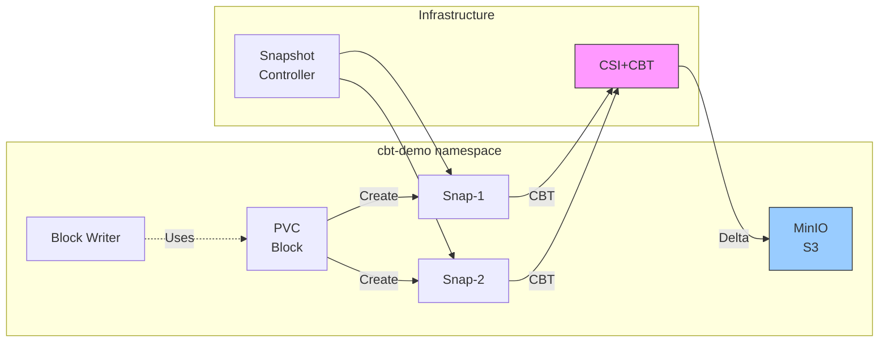
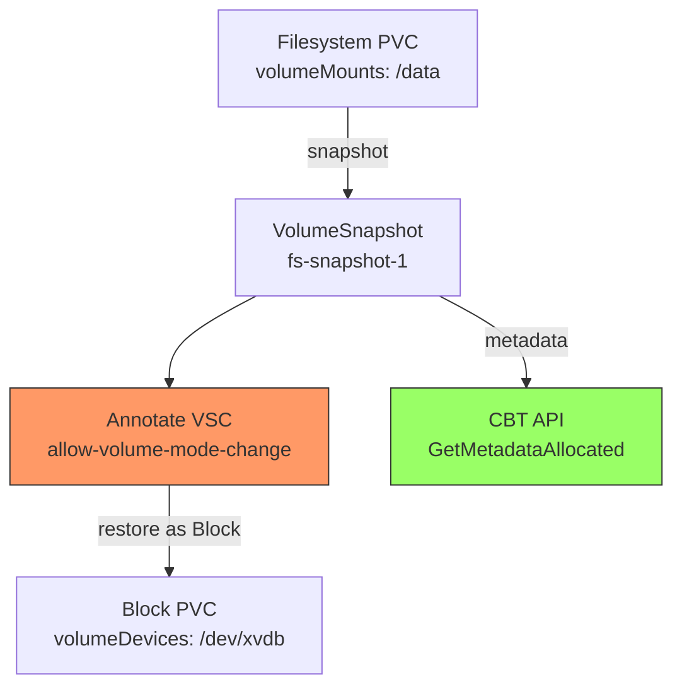

# K8s CBT S3Mover Demo

Efficient Backup with Changed Block Tracking

<div class="pt-12">
  <span @click="$slidev.nav.next" class="px-2 py-1 rounded cursor-pointer" hover="bg-white bg-opacity-10">
    Press Space to begin <carbon:arrow-right class="inline"/>
  </span>
</div>

<!--
Welcome! This presentation demonstrates Changed Block Tracking (CBT) in Kubernetes.
- Introduce yourself and your role
- Mention timeline: K8s 1.33 alpha, OCP 4.20 DevPreviewNoUpgrade, K8s 1.36 beta
- Set expectations: ~25 minute talk with technical deep-dive
- Audience: DevOps engineers, backup admins, K8s storage users
-->


---
transition: slide-left
---

# What is CBT?

Changed Block Tracking (**KEP-3314**) identifies **only the blocks** that have changed between snapshots, enabling efficient incremental backups.

<div class="grid grid-cols-2 gap-8 mt-4">
<div>

<v-clicks>

- **K8s 1.33** — Alpha (no feature gate)
- **OCP 4.20** — DevPreviewNoUpgrade
- **K8s 1.36** — Beta (`SnapshotMetadataService` v1beta1)
- **OCP 4.23 / 5.0** — Expected on K8s 1.36 (beta); provisional, from CI builds

</v-clicks>

<v-click>
<div class="mt-4 p-2 bg-yellow-900 bg-opacity-20 rounded text-sm">

CBT operates on the **block device layer** — the source volume can use either Block or Filesystem mode

</div>
</v-click>

</div>
<div>

<v-click>



</v-click>

</div>
</div>

<!--
- Define CBT upfront so the audience has context for the history slides
- KEP-3314 introduces CBT as alpha in K8s 1.33+ (no feature gate), OCP 4.20 DevPreviewNoUpgrade
- Timeline: K8s 1.36 beta; OCP 4.23 / 5.0 on K8s 1.36 is provisional (seen in CI builds, not confirmed by GA release notes), last 4.x expected to be 4.23; external-snapshot-metadata v1.1.0 is the current beta sidecar release
- Note: CBT works at block layer regardless of volume mode (Filesystem or Block)
-->

---
transition: slide-left
---

# The "Holy Grail" of Efficient Backups

<div class="grid grid-cols-2 gap-4">
<div>

### The Problem
If you have a **1TB disk** but only change **1MB of data**, you don't want to back up the whole 1TB again.

### The Gap
For a long time:
- **Ceph** had the *ability* to track changes.
- **Kubernetes** had no standard way to *ask* for them.

The evolution of CBT is essentially the story of closing that communication gap.

</div>
<div>

<div class="flex items-center justify-center h-full">
<div class="text-center p-4 bg-gray-100 rounded-lg dark:bg-gray-800">
  <div class="text-6xl mb-4">🏆</div>
  <div class="text-xl font-bold">Tracking Changes</div>
  <div class="text-sm opacity-75">Between Snapshots</div>
</div>
</div>

</div>
</div>

---
transition: slide-left
---

# 1. The "Native" Era (What Ceph always had)

It is important to understand that Ceph's backend (**RBD**) has supported this for years.

<v-clicks>

- **The Tool**: `rbd diff`
- **How it works**:
  - Given `Snapshot-A` and `Snapshot-B`
  - Ceph returns a list of exactly which blocks changed.
- **The Problem**:
  - Kubernetes didn't know this command existed.
  - **CSI** was designed to *create* and *delete* volumes, not to inspect their data contents.

</v-clicks>

---
transition: slide-left
---

# 2. The "Workaround" Era (Pre-Standardization)

Before KEP-3314, backup tools (Velero, Kasten) had two bad choices:

<div class="grid grid-cols-2 gap-8 mt-8">

<v-click>
<div class="p-4 border border-red-500 rounded bg-red-50 dark:bg-red-900/20">
  <h3 class="text-red-600 dark:text-red-400 font-bold">The "Full Scan" Method</h3>
  <p class="mt-2">Read the entire disk every time to find changes.</p>
  <div class="mt-4 text-sm font-mono">Result: Slow & Expensive 🐢</div>
</div>
</v-click>

<v-click>
<div class="p-4 border border-orange-500 rounded bg-orange-50 dark:bg-orange-900/20">
  <h3 class="text-orange-600 dark:text-orange-400 font-bold">The "Proprietary" Method</h3>
  <p class="mt-2">Bypass K8s and talk directly to Ceph API.</p>
  <div class="mt-4 text-sm font-mono">Result: Broken Portability 🔒</div>
</div>
</v-click>

</div>

---
transition: slide-left
---

# 3. The "Modern" Era (KEP-3314)

**KEP-3314: CSI Snapshot Metadata Service** changed the architecture.

<div class="mt-4">

| Component | Old Ceph CSI | New Ceph CSI (With CBT) |
| :--- | :--- | :--- |
| **Primary Job** | Mount/Unmount volumes | Mount/Unmount + **Serve Metadata** |
| **New Sidecar** | None | **`external-snapshot-metadata`** |
| **New RPC Call** | None | `GetMetadataDelta` (The magic command) |
| **Data Flow** | K8s $\rightarrow$ Ceph | K8s $\rightarrow$ Sidecar $\rightarrow$ Ceph CSI $\rightarrow$ `rbd diff` |

</div>

<div class="mt-4 text-sm opacity-75">
Instead of just being a "dumb" driver, Ceph CSI now exposes `rbd diff` data to Kubernetes in a standard way.
</div>

---
transition: slide-left
---

# How it works today (The Workflow)

When a backup tool (like Velero) runs with CBT enabled:

<v-clicks>

1.  **Ask**: Backup tool asks K8s for "Delta" between snapshots
2.  **Route**: Request goes to **CSI Snapshot Metadata Service**
3.  **Translate**: **Ceph CSI driver** translates to `rbd diff`
4.  **Respond**: Ceph responds with offset list of changed blocks
5.  **Transfer**: Backup tool downloads *only* those specific blocks

</v-clicks>

<v-click>
<div class="mt-8 p-3 bg-blue-100 dark:bg-blue-900/30 rounded text-center text-sm">
  Ceph is just one example. This is a standard, so more vendors will support it in the future.
</div>
</v-click>

<!--
- Ceph is used as an example because it already has rbd diff
- The standard (KEP-3314) makes this portable across CSI drivers
- Any vendor can implement SnapshotMetadata gRPC service
-->

---
transition: slide-left
---

# Key Benefits of CBT

<v-clicks>

- **Shorter Backup Windows** — Hours to minutes for large datasets
- **Smart Initial Backups** — Only allocated blocks transferred
- **Reduced Resource Usage** — Less network bandwidth and I/O
- **Lower Storage Costs** — No redundant full backups needed
- **True Incremental Backups** — Only changed blocks after initial

</v-clicks>

<!--
- Highlight the time savings (hours to minutes) for large datasets
- Show the diagram animation to illustrate the delta concept
- Emphasize adoption path from alpha to beta across both K8s and OpenShift
-->

---
layout: two-cols
---

# User Stories

## 📦 Full Snapshot Backup

<v-click>

**Actor**: Backup Application
**Goal**: Initial backup of 1TB block volume

**Workflow**:
1. Create VolumeSnapshot of target PVC
2. Query `GetMetadataAllocated` API
3. Receive allocated blocks list (e.g., 400GB)
4. Mount snapshot as block PVC in pod
5. Transfer only allocated blocks to S3

**Result**: Back up 400GB instead of 1TB
**Benefit**: 60% reduction in transfer time

</v-click>

::right::

## 🔄 Incremental Snapshot Backup

<v-click>

**Actor**: Backup Application
**Goal**: Daily backup after data changes

**Workflow**:
1. Create new VolumeSnapshot
2. Query `GetMetadataDelta(base, new)`
3. Receive changed blocks (e.g., 50GB)
4. Mount latest snapshot in pod
5. Transfer only delta blocks to S3

**Result**: Back up 50GB instead of 400GB
**Benefit**: 87.5% reduction in transfer time

</v-click>

<!--
User stories provide practical context:
- Full backup: Shows sparse region skipping (400GB used in 1TB volume)
- Incremental: Shows delta efficiency (50GB changes vs 400GB full)
- Both demonstrate GetMetadataAllocated and GetMetadataDelta APIs
- Real-world numbers help audience understand impact
-->

---
layout: default
---

# CBT API Architecture (KEP-3314)

<div grid="~ cols-2 gap-8" class="text-sm">
<div>

## Three Key Components

<v-clicks depth="2">

1. **CSI SnapshotMetadata Service API**
   - `GetMetadataAllocated` RPC
   - `GetMetadataDelta` RPC

2. **SnapshotMetadataService CRD**
   - Advertises service availability
   - Connection details & CA cert

3. **External Snapshot Metadata Sidecar**
   - Validates K8s auth tokens
   - Translates names to handles
   - Forwards requests to CSI

</v-clicks>

</div>
<div>

<v-click>

## Security Model

- **Authentication**: TokenRequest API
- **Authorization**: RBAC + SubjectAccessReview
- **Transport**: Mutual TLS
- **Token scoping**: Audience-bound

</v-click>

<v-click>

<div class="mt-3">

## Metadata Formats

- **FIXED_LENGTH**: Uniform blocks
- **VARIABLE_LENGTH**: Variable extents

<div class="text-xs mt-1 opacity-70">
Both support resumption via `starting_offset`
</div>

</div>

</v-click>

</div>
</div>

<!--
Technical architecture overview:
- Three key components: Service API (gRPC), CRD (advertises service), Sidecar (auth/translation)
- Security is built-in: TokenRequest API, RBAC, mTLS
- Two metadata formats: FIXED_LENGTH (uniform blocks) vs VARIABLE_LENGTH (extents)
- Resumption support via starting_offset is crucial for large snapshots
- Point out this follows cloud provider CBT patterns (AWS EBS direct APIs, Azure incremental snapshots)
-->

---
layout: default
---

# Demo Architecture

<div grid="~ cols-2 gap-0" class="text-xs">
<div>

## Components

<v-clicks>

1. **CSI Driver** with CBT
   - hostpath (demo), Ceph RBD (production; delta needs the base retained)
   - SnapshotMetadata service

2. **MinIO** S3 storage
   - S3-compatible object storage
   - Backup target

3. **Block Writer** workload
   - Writes directly to raw block device
   - Block device PVC (/dev/xvda)

4. **Snapshot Controller**
   - VolumeSnapshot CRDs
   - Lifecycle management

</v-clicks>

</div>
<div v-click>



</div>
</div>

<!--
Demo components walkthrough:
- LEFT: Explain the layered architecture from app to infrastructure
- RIGHT: Walk through the mermaid diagram
- CSI Driver: Note it includes both hostpath plugin AND snapshot-metadata sidecar
- MinIO: S3-compatible storage, easier than setting up real S3
- Block Writer: Writes directly to raw block device /dev/xvda, bypassing filesystem for CBT visibility
- Snapshot Controller: Manages VolumeSnapshot lifecycle
- Emphasize: Everything runs in a single namespace for simplicity
-->

---
layout: default
---

# Phase 1: Setup & Deploy

<v-clicks depth="2">

1. **Deploy Kubernetes Cluster** — Minikube with vfkit (4 CPUs, 8GB RAM)
2. **Install Snapshot CRDs** — VolumeSnapshot, VolumeSnapshotContent, VolumeSnapshotClass
3. **Deploy CSI Driver with CBT**
   ```bash
   ./scripts/01-deploy-csi-driver.sh
   # Installs SnapshotMetadataService CRD + enables CBT API
   ```
4. **Deploy MinIO S3 Storage** — `./scripts/02-deploy-minio.sh`
5. **Deploy Block Writer** — `./scripts/03-deploy-workload.sh`
   - Creates block PVC, writes 100 blocks to raw device

</v-clicks>

<v-click>

<div class="mt-4 p-2 bg-blue-900 bg-opacity-20 rounded text-sm">

**snapshot-metadata-lister pod**: Bridges K8s RBAC and CSI driver access. Uses ServiceAccount tokens via TokenRequest API, translates snapshot names to CSI handles, connects to SnapshotMetadataService over TLS (port 6443).

</div>

</v-click>

<!--
Setup and deployment combined into one slide:
- Minikube is default, but supports any K8s cluster via KUBECONFIG
- Snapshot CRDs must be installed BEFORE CSI driver
- CSI driver deployment includes TLS cert generation and sidecar injection
- snapshot-metadata-lister acts as authenticated client for CBT APIs
- macOS: Use vfkit driver (not Podman) for block volume support
-->

---

# Phase 2: GetMetadataAllocated

<v-clicks>

- **Create First Snapshot** — `kubectl apply -f block-snapshot-1.yaml` (~4s)
- **Deploy snapshot-metadata-lister** — Pod ready in ~62 seconds

</v-clicks>

<v-click>

```bash
# Call GetMetadataAllocated API
kubectl exec csi-client -- /tools/snapshot-metadata-lister \
  -s block-snapshot-1 -n cbt-demo
```

</v-click>

<v-click>

**Real output** from CI:

```text
Discovered SnapshotMetadataService: address=csi-snapshot-metadata.default:6443
Connected to CSI SnapshotMetadata service
Getting allocated blocks...
  Found 42 allocated blocks
Total allocated size: 172032 bytes (0.16 MB)
Volume size: 1073741824 bytes (1024.00 MB)
Data transfer savings: 99.98%
```

</v-click>

<!--
- Snapshot creation is fast (~4 seconds)
- Real CBT API output: 42 blocks of 4096 bytes = 172KB
- Only ~0.02% of 1Gi volume is allocated
- 99.98% data transfer savings
-->

---
layout: default
---

# Phase 3: GetMetadataDelta

<v-clicks>

- **Write 100 more blocks** — `dd if=/dev/urandom of=/dev/xvda bs=4096 count=100`
- **Create Second Snapshot** — `kubectl apply -f block-snapshot-2.yaml` (~3.7s)

</v-clicks>

<v-click>

```bash {all}{maxHeight:'150px'}
# Get CSI snapshot handle from VolumeSnapshotContent
VSC=$(kubectl get volumesnapshot block-snapshot-1 -n cbt-demo \
  -o jsonpath="{.status.boundVolumeSnapshotContentName}")
HANDLE=$(kubectl get volumesnapshotcontent $VSC \
  -o jsonpath="{.status.snapshotHandle}")

# Call GetMetadataDelta using CSI handle (PR #180)
kubectl exec csi-client -- /tools/snapshot-metadata-lister \
  -P "$HANDLE" -s block-snapshot-2 -n cbt-demo
```

</v-click>

<v-click>

<div class="mt-3 p-3 bg-blue-900 bg-opacity-20 rounded text-sm">

**PR #180: CSI Handle Support** (merged Oct 2025) — `GetMetadataDelta` accepts CSI snapshot handles instead of names, so the API no longer needs the VolumeSnapshot object. The driver may still need the snapshot itself: Ceph RBD does (Case 2). Backward compatible.

</div>

</v-click>

<!--
- Write 100 more blocks to raw device to simulate data changes
- Uses CSI handle approach (PR #180) instead of snapshot names
- API benefit: the VolumeSnapshot object is no longer required
- Driver caveat: Ceph RBD still needs the base snapshot to exist for the delta
- This is the key efficiency gain - only ~400KB delta vs full ~800KB
-->

---
layout: default
---

# Phase 4: Filesystem-to-Block Conversion

**Velero Block Data Mover pattern**: backupPVC is always Block mode, regardless of source.

<div class="grid grid-cols-2 gap-6">
<div>

<v-clicks>

- **Source PVC**: `volumeMode: Filesystem`
  - Normal app writes files to `/data/`
- **Snapshot**: Created from Filesystem PVC
- **Annotate** VolumeSnapshotContent
- **BackupPVC**: `volumeMode: Block`
  - Restored from snapshot with mode change
- **CBT**: Works on block layer transparently

</v-clicks>

</div>
<div>

<v-click>



</v-click>

</div>
</div>

<v-click>

<div class="mt-2 p-2 bg-yellow-900 bg-opacity-20 rounded text-xs">

**Key**: The `snapshot.storage.kubernetes.io/allow-volume-mode-change` annotation on VolumeSnapshotContent is required to change volume modes. Without it, the external-provisioner rejects the PVC. In Velero, the CSI Snapshot Exposer adds this annotation automatically.

</div>

</v-click>

<!--
- KEP-3314 Non-Goal: "The volume could be attached to a pod with either Block or Filesystem volume modes"
- Velero's CSI Snapshot Exposer uses getVolumeModeByAccessMode() which returns Block for data mover
- The annotation is a security feature: prevents accidental volume mode changes
- This came from a real CI failure - discovered the annotation requirement through iteration
- Important for anyone building CBT tooling outside Velero
- Validates the complete flow from filesystem apps to block-level CBT backup
-->

---
layout: default
---

# Phase 5: Disaster Recovery

<v-clicks>

- **Simulate Disaster** — `./scripts/05-simulate-disaster.sh`
  - Deletes pod and PVC, preserves snapshots
- **Restore from Snapshot** — `./scripts/06-restore.sh cbt-demo block-snapshot-2`
  - Creates new PVC from snapshot, redeploys workload
- **Verify Recovery** — `./scripts/07-verify.sh cbt-demo`
  - Compares checksums, confirms data integrity

</v-clicks>

<v-click>
<div class="mt-4 p-3 bg-green-900 bg-opacity-20 rounded text-sm">

**Result**: Data integrity preserved — post-restore checksum matches pre-disaster

</div>
</v-click>

<!--
- Demonstrates end-to-end disaster recovery using snapshots
- Simulate disaster by deleting workload but preserving snapshots
- Restore creates PVC from snapshot (native K8s restore)
- Verify ensures data integrity with checksum comparison
- Snapshots provide crash-consistent recovery points
-->

---
layout: default
---

# Velero CBT Status (Oct 2026)

**Velero 1.19.0 supports Case 1, not Case 2.** Delta = only the blocks that changed.

<p class="text-sm opacity-75">Case = does the storage driver need the old (base) snapshot to still exist?</p>

<div class="grid grid-cols-2 gap-6 mt-4">
<div>

<v-click>

### Case 1: no base snapshot needed

- The storage driver computes the delta without the base being present
- vSphere (works)
- Unchanged in 1.19.0

</v-click>

</div>
<div>

<v-click>

<div class="inline-block px-2 py-1 rounded bg-red-600 text-white text-xs font-bold mb-2">NOT SUPPORTED</div>

### Case 2: base snapshot required

- `GetMetadataDelta` needs the base to still exist
- Ceph RBD (does NOT work in 1.19.0)
- <span class="text-red-500 font-bold">Not supported in 1.19.0</span>

</v-click>

</div>
</div>

<v-click>

<div class="mt-4 p-3 bg-yellow-900 bg-opacity-20 rounded text-sm">

<p><strong>1.19.0:</strong> backup snapshots are always deleted afterward (same as 1.18).</p>
<p class="mt-1"><strong>#10307</strong> (copy the snapshot class's delete setting): being undone. <strong>#10294</strong> (fix for the change-tracking ID): stays.</p>

</div>

</v-click>

<!--
- Status agreed at the 2026-10-27 Velero community meeting
- AWS EBS is not applicable: its CSI driver does not implement snapshot metadata
- The file system data mover never retains snapshots
- Keep this factual: Case 2 was designed, not shipped in 1.19.0
-->

---
layout: default
---

# Ceph RBD on Velero 1.19.0

<div class="grid grid-cols-2 gap-6 text-sm">
<div>

<v-click>

### What 1.19.0 does

<p class="mb-2">Base = the old snapshot we compare against. Velero deletes it, so the comparison fails, and Velero copies everything.</p>

1. Velero keeps no base: the snapshot class is set to `Delete`
2. `GetMetadataDelta` fails: `no snap source in omap` (Ceph's lookup table)
3. Velero's data mover (the robot that copies disk blocks) falls back to a full copy (`fallbackFull`)

</v-click>

<v-click>

<div class="mt-3 p-3 bg-green-900 bg-opacity-20 rounded text-sm">
<p><strong>Backups are still correct.</strong> They just copy everything each time instead of only changes (slower, bigger).</p>
<p class="mt-1">The file system data mover never keeps snapshots.</p>
</div>

</v-click>

</div>
<div>

<v-click>

### What was tested early (base kept, NOT 1.19.0)

<div class="mt-2 p-2 bg-blue-900 bg-opacity-20 rounded text-sm">
Validated with the base snapshot kept, on pre-release builds. These are not 1.19.0 results as shipped.
</div>

</v-click>

<v-click>

<ul class="mt-2">
<li>Only changed blocks were sent on Ceph storage on OpenShift (Rook and ODF setups)</li>
<li>Second backup sent only 150,994,944 bytes</li>
<li>Whole-disk checksum (SHA-256) matched at every restore point</li>
<li>VM booted; multi-disk VM (including hotplug, a disk added while running) matched checksums</li>
<li>In-place restore (onto the existing disk): 30 GiB, 270,532,608 bytes sent, 22 s</li>
</ul>

</v-click>

</div>
</div>

<!--
- The fallback is the evidence for Case 2: delete the base, lose the delta
- Negative test: base deleted with a Delete class
- Sources: KEP-3314, ceph-csi sms_controllerserver.go, block data mover design
- Do not present these numbers as 1.19.0 behavior
-->

---
layout: default
---

# Case 2 Design In Progress

<div grid="~ cols-2 gap-8" class="text-sm">
<div>

<v-click>

### Tracking

- Umbrella issue: [#10743](https://github.com/velero-io/velero/issues/10743) (tracks the work)
- Design issue: [#10744](https://github.com/velero-io/velero/issues/10744) (the proposal)
- Target: a 1.19.x patch

</v-click>

<v-click>

### Proposal (not settled)

**How it picks**

1. Volume policy `retainBaseSnapshot` (working name) says keep -> keep the base snapshot
2. Else auto-detect from `requireBaseSnapshotForDelta`
3. Else default: do not keep

</v-click>

</div>
<div>

<v-click>

### Timeline

- CBT on Ceph is delayed, not dropped
- Aimed at a 1.19.x patch (OADP 1.7, Red Hat's Velero product), not committed

</v-click>

<v-click>

### Snapshot rules

- Velero alone decides; the class delete setting (`deletionPolicy`) plays no part
- A chain (base + follow-ups) keeps the newest snapshot
- After the next backup, Velero deletes the older one; deleting a backup deletes its kept snapshot

</v-click>

<v-click>

### In flight

- <span class="text-green-600 font-bold">MERGED</span> #10698, #10696, #10700
- <span class="text-yellow-600 font-bold">OPEN</span> #10699, #10708, #10710, #10718
- <span class="text-blue-600 font-bold">DRAFT</span> #10691 (candidate for #10744)
- <span class="text-red-600 font-bold">CLOSED</span> #10716 (superseded by the #10307 rollback)

</v-click>

</div>
</div>

<!--
- The parameter name is a working name; do not write it into tests yet
- external-snapshot-metadata#258 merged the CRD field; it is not released
- ceph-csi#6680 asks RBD to set the field; velero#10722 (issue) proposes reading it
- Keep the OADP 1.7 statement as a target, not a commitment
-->

---
layout: two-cols
---

# Build Tools

<div class="text-sm">

<v-click>

## Backup Tool (cbt-backup)

**Built in CI** (build-backup-tool job):

```bash
cd tools/cbt-backup
go mod tidy
go build -v -o cbt-backup ./cmd
```

**Purpose**: Production backup use case
- Integrates CBT APIs for efficient backups
- Uploads to S3-compatible storage
- Supports incremental backups

**Status**: Built and tested in CI, available as artifact

</v-click>

</div>

::right::

<v-click>

## Restore Scripts

```bash
# Dry-run (validate only)
./scripts/restore-dry-run.sh \
  cbt-demo block-snapshot-1

# Full restore from snapshot
./scripts/06-restore.sh \
  cbt-demo block-snapshot-2
```

</v-click>

<v-click>

**Status:**
- `06-restore.sh`: Functional (used in Phase 5)
- `restore-dry-run.sh`: Validation only
- `cbt-restore`: Built, needs block upload in backup

</v-click>

---
layout: center
class: text-center
---

<div class="text-sm">

# Data Integrity

<v-clicks>

## Verification Process

```bash
./scripts/integrity-check.sh
```

<div class="text-xs">

Checks: Snapshot checksums • Block-level consistency • Block device data • Backup metadata

</div>

</v-clicks>

<v-click>

## Results

<div class="text-left mx-auto max-w-2xl mt-4">

| Check | Snapshot 1 | Snapshot 2 |
|-------|-----------|-----------|
| Blocks | 100 | 200 |
| Size | ~400KB | ~800KB |
| Delta | - | ~400KB |
| Checksum | ✓ MD5 | ✓ MD5 |

</div>

</v-click>

</div>

---
layout: default
---

# Troubleshooting

<v-clicks depth="2">

## Common Issues

1. **Snapshot not ready**
   ```bash
   kubectl describe volumesnapshot block-snapshot-1 -n cbt-demo
   kubectl logs -n kube-system -l app.kubernetes.io/name=snapshot-controller
   ```

2. **CSI Driver issues**
   ```bash
   kubectl logs -n default csi-hostpathplugin-0 --all-containers
   kubectl describe pod -n default csi-hostpathplugin-0
   ```

3. **CBT CRD missing**
   ```bash
   kubectl get crd snapshotmetadataservices.cbt.storage.k8s.io
   ./scripts/validate-cbt.sh
   ```

</v-clicks>

---
layout: default
---

# CI/CD Pipeline

**Total Time**: ~13 minutes (jobs run in parallel)

<div grid="~ cols-4 gap-4">
<div>

<v-click>

## demo

**End-to-end test** (~12m)
- Setup cluster
- Deploy CSI + CBT
- CBT backup (42 blocks)
- FS-to-Block conversion
- Verifier + restore
- **Result**: ✓ Success

</v-click>

</div>
<div>

<v-click>

## build-backup-tool

**Build & test** (~1m 20s)
- Go 1.26
- Download deps
- Build binary
- Run tests
- **Result**: ✓ Success

</v-click>

</div>
<div>

<v-click>

## lint

**Code quality** (~1m 15s)
- shellcheck scripts
- go fmt
- go vet
- **Result**: ✓ Success

</v-click>

</div>
<div>

<v-click>

## build-restore-tool

**Build & artifact** (~40s)
- Build binary
- Upload artifact
- Used by demo job
- **Result**: ✓ Success

</v-click>

</div>
</div>

<!--
CI/CD automation highlights:
- 4 parallel jobs: demo (end-to-end), build-backup-tool, lint, build-restore-tool
- Total time: ~13 minutes for full validation including in-cluster backup/restore
- Demo job now includes filesystem-to-block conversion test
- CBT backup uses real GetMetadataAllocated API (42 blocks, 172KB, 99.98% savings)
- Runs on every push/PR to main/develop branches
-->

---
layout: default
---

# CI Results

<div class="text-sm">

<div class="grid grid-cols-2 gap-6">
<div>

<v-click>

## Infrastructure Deployed

- **Cluster**: Minikube (4 CPUs, 8GB RAM)
- **CSI Driver**: hostpath + metadata sidecar (results below are from an earlier run; the demo now deploys hostpath v1.18.0 + sidecar v1.1.0)
- **TLS**: Fresh certs generated per run

| Component | Result |
|-----------|--------|
| GetMetadataAllocated | 42 blocks (172KB) |
| Verifier (allocated) | ✓ Pass |
| Negative test | ✓ Mismatch detected |
| FS-to-Block conversion | ✓ Pass |
| In-cluster backup | ✓ CBT Enabled: true |

</v-click>

</div>
<div>

<v-click>

## CBT Backup Results

- **Volume**: 1 GB (1,073,741,824 bytes)
- **Allocated Blocks**: 42 (172,032 bytes)
- **Data Transfer Savings**: **99.98%**
- **Backup Duration**: 6 seconds
- **Block data uploaded to S3**: ✓

**In-cluster Jobs** (Velero pattern):
- `cbt-backup`: Full backup via CBT API
- `cbt-restore`: Block-level restore from S3

</v-click>

</div>
</div>

</div>

<!--
- Real CBT API usage: GetMetadataAllocated returns 42 allocated blocks
- 99.98% data transfer savings (172KB from 1GB volume)
- Upstream verifier confirms metadata matches device contents
- Negative test correctly detects data mismatch
- FS-to-Block conversion validates Velero Block Data Mover pattern
- In-cluster backup/restore jobs follow Velero pattern
-->

---
layout: center
class: text-center
---

# Demo Results

<v-clicks>

## What We Demonstrated

1. ✅ **Real CBT API usage** — GetMetadataAllocated returns 42 allocated blocks
2. ✅ **99.98% data savings** — 172KB transferred from 1GB volume
3. ✅ **In-cluster backup/restore** — Velero-pattern Jobs with block device access
4. ✅ **TLS + SA token auth** — Secure gRPC to SnapshotMetadata sidecar
5. ✅ **Upstream verifier** — Confirms metadata matches actual device contents
6. ✅ **Block data to S3** — Full backup with MinIO integration
7. ✅ **Filesystem → Block conversion** — Velero Block Data Mover pattern validated

## Key Takeaway

<div class="text-2xl mt-8 text-green-400">
CBT enables <strong>99.98% reduction</strong> in backup data transfer
</div>

</v-clicks>

<!--
Summary of achievements:
- Real CBT: GetMetadataAllocated found 42 blocks (not a simulation)
- 172KB from 1GB = 99.98% savings
- In-cluster Jobs mount block PVCs and upload to S3
- TLS-secured gRPC with SA token from SnapshotMetadataService CR
- Upstream snapshot-metadata-verifier validates correctness
- Block data uploaded to MinIO S3 and restored successfully
- FS-to-Block validates the Velero Block Data Mover design
-->

---
layout: default
---

# Current Status

<div grid="~ cols-2 gap-8">
<div>

<v-click>

## ✅ What Works End-to-End

**CBT API (Real Data)**
- GetMetadataAllocated: 42 blocks returned
- GetMetadataDelta: Delta between snapshots
- Upstream verifier: Metadata matches device
- 99.98% data transfer savings

**In-Cluster Backup/Restore**
- cbt-backup Job: CBT → read blocks → S3
- cbt-restore Job: S3 → write blocks → device
- TLS + SA token gRPC auth
- Filesystem → Block volume mode conversion
- Service discovery from SnapshotMetadataService CR

</v-click>

</div>
<div>

<v-click>

## Remaining Limitations

**CSI Driver Support**
- hostpath driver: Full CBT support (demo)
- Ceph RBD: CBT works; the delta needs the base snapshot retained
- Velero 1.19.0: Ceph RBD incrementals fall back to full (Case 2 not supported)
- AWS EBS: does not implement CBT

**ARM64 Architecture**
- grpc_health_probe: AMD64-only in upstream
- Fix: `multiarch-grpc-health-probe` branch

**Incremental Restore**
- Snapshot chain resolution: Implemented
- Multi-snapshot restore: Needs testing

</v-click>

</div>
</div>

<v-click>

<div class="mt-4 p-3 bg-green-900 bg-opacity-30 rounded text-sm">

💡 **This demo is fully functional**: Real CBT API calls, block-level backup to S3, and restore — all running as in-cluster Jobs following the Velero pattern. Velero's Ceph retention work is tracked in #10743 and #10744.

</div>

</v-click>

<!--
Status update:
- LEFT: Everything that works end-to-end with real CBT data
- RIGHT: Driver and Velero limitations, stated as they are today
- Key message: Demo is fully functional, not just infrastructure validation
- Ceph RBD CBT works when the base snapshot is retained; Velero 1.19.0 does not retain it
-->

---
layout: default
---

# Try It Yourself

<v-clicks>

## Quick Start

```bash
git clone <repo-url>
./scripts/01-deploy-csi-driver.sh
./scripts/02-deploy-minio.sh
./scripts/03-deploy-workload.sh
./scripts/04-run-demo.sh
```

## Demo Resources

- **Docs**: `README.md`
- **Scripts**: `scripts/` directory
- **Tools**: `tools/cbt-backup/`
- **CI**: `.github/workflows/demo.yaml`

</v-clicks>

<!--
Call to action:
- Encourage audience to try the demo themselves
- It's fully automated with scripts - just run them in order
- Works on Minikube or any K8s cluster
- All code is open source and documented
- Point to README.md for details
- Mention: a good way to learn the API before relying on CBT in production; driver support and retention rules differ
-->

---
layout: default
---

# Official Resources

<div grid="~ cols-2 gap-4">
<div>

<v-click>

## Kubernetes Documentation

- 📘 [KEP-3314: CSI Changed Block Tracking](https://github.com/kubernetes/enhancements/tree/master/keps/sig-storage/3314-csi-changed-block-tracking)
- 📚 [CSI Developer Docs](https://kubernetes-csi.github.io/docs/external-snapshot-metadata.html)
- 📝 [Kubernetes Blog Post](https://github.com/kubernetes/website/pull/48456) (upcoming)

</v-click>

</div>
<div>

<v-click>

## Implementation References

- 🔧 [external-snapshot-metadata](https://github.com/kubernetes-csi/external-snapshot-metadata) repo
- 📋 [schema.proto](https://github.com/kubernetes-csi/external-snapshot-metadata/blob/main/proto/schema.proto) - gRPC API definitions
- 💡 [snapshot-metadata-lister](https://github.com/kubernetes-csi/external-snapshot-metadata/tree/main/examples/snapshot-metadata-lister) example
- 🔨 [csi-hostpath-driver](https://github.com/kubernetes-csi/csi-driver-host-path) with CBT
- [Velero block data mover design](https://github.com/velero-io/velero/blob/main/design/block-data-mover/block-data-mover.md)
- [Velero Case 2 tracking (#10743)](https://github.com/velero-io/velero/issues/10743)

</v-click>

</div>
</div>

<v-click>

## Get Involved

- 🤝 Join [SIG Storage](https://github.com/kubernetes/community/tree/master/sig-storage)
- 🗓️ Attend [Data Protection Working Group](https://docs.google.com/document/d/15tLCV3csvjHbKb16DVk-mfUmFry_Rlwo-2uG6KNGsfw/edit) meetings

</v-click>

<!--
Resources and community:
- KEP-3314 is the source of truth for CBT specification
- external-snapshot-metadata repo has reference implementation
- Point to schema.proto for gRPC API definitions
- snapshot-metadata-lister example shows how to use the APIs
- Encourage joining SIG Storage and Data Protection Working Group
- Drivers are shipping CBT support; retention semantics still differ by driver
-->

---
layout: center
class: text-center
---

# Thank You!

Questions?

<div class="pt-12 text-sm opacity-50">
  <p>K8s CBT S3Mover Demo</p>
  <p>Efficient backup with Changed Block Tracking</p>
</div>

<!--
Closing:
- Thank the audience for their time
- Open floor for questions
- Common questions to anticipate:
  - When will production CSI drivers support CBT? (Vendor-dependent, ask your CSI provider)
  - Does this work with EBS/Azure Disk? (Not yet, but KEP-3314 enables it)
  - Does Velero support Ceph CBT today? (Not in 1.19.0: Ceph RBD incrementals fall back to full. Case 2 design targets 1.19.x, targeted for OADP 1.7)
  - Is this production-ready? (Beta in K8s 1.36+, alpha since 1.33; API is v1beta1, CSI driver support needed)
  - How does this compare to cloud provider CBT? (Similar concept, K8s provides standardized API)
- Provide contact info or repo link for follow-up questions
-->
